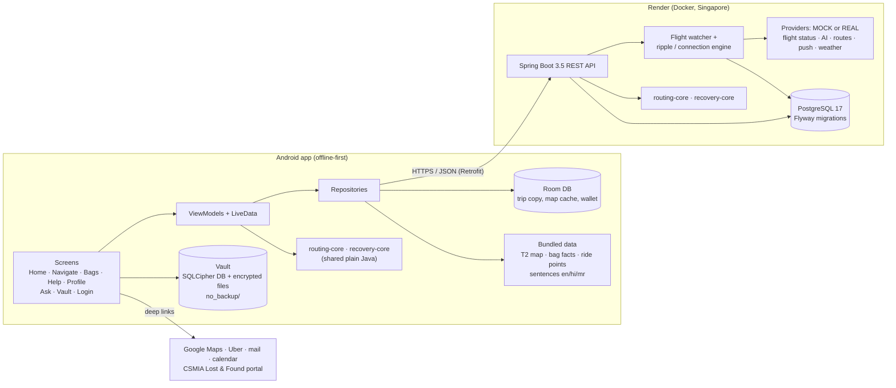
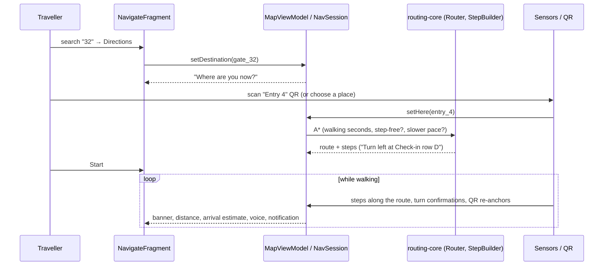
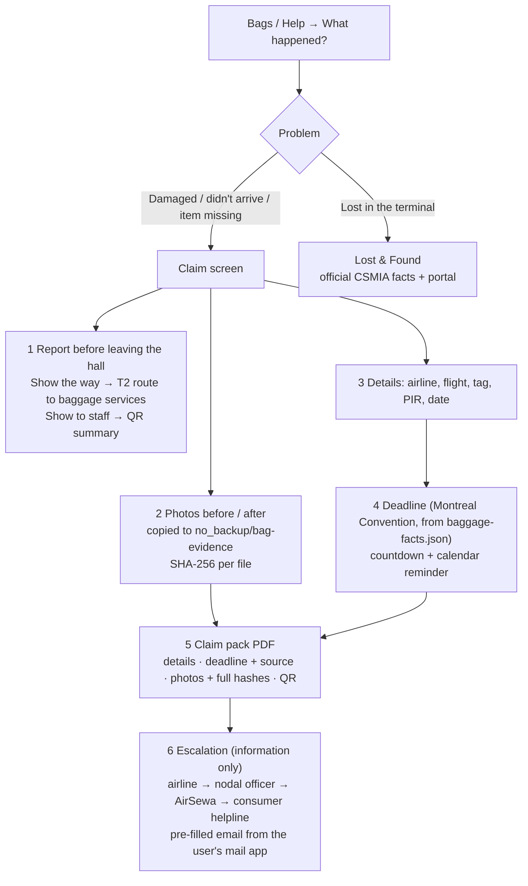
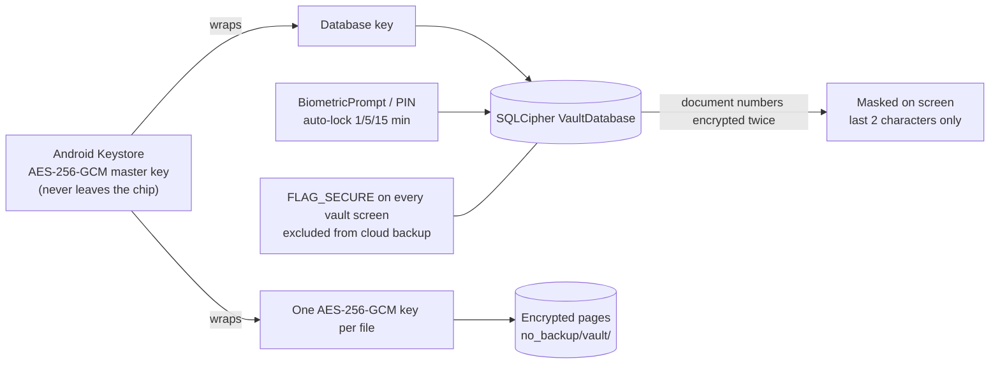
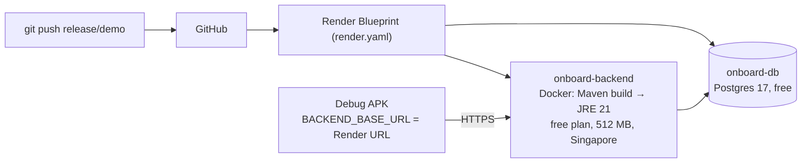

# OnBoard — Architecture

How the pieces fit together, as built for the Elevate 1.0 demo (branch `release/demo`, 11 Oct 2026). The diagrams are
[Mermaid](https://mermaid.js.org/): GitHub draws them as pictures (screenshot them for slides). The earlier plan's
architecture (trip timeline, ripple engine) is kept in [archive/architecture-phase1-2.md](archive/architecture-phase1-2.md).

## 1. Big picture

**Three ideas run through everything:**

1. **Offline first.** What a traveller needs inside a terminal (map, routes, instructions, bag guide, documents,
   quick answers) ships inside the app or is saved on the phone. The server adds fresher data when there is signal;
   Room is the screen's source of truth.
2. **One engine, two builds.** The airport map model, the A* router, the turn-by-turn sentences and the connection
   checker are plain Java in `routing-core/` and `recovery-core/`, compiled into both the app and the backend, so
   phone and server always agree. Both are JUnit-tested.
3. **Every outside service sits behind an interface with a mock.** The whole demo runs with zero API keys. The
   backend prints MOCK/REAL per provider at startup and in `GET /api/health`.

## 2. Android app

**Pattern:** Fragment → ViewModel + LiveData → Repository → (Room | Retrofit | assets). Manual dependency injection
through `ServiceLocator` (no Hilt). Java 17, XML layouts, Material 3, minSdk 26, targetSdk 37 (edge-to-edge).

| Package | What it does |
|---|---|
| `ui/home` | Greeting, Ask bar, flight card (gate/boarding "not announced yet" until a source says otherwise), "Navigate to gate", Google Maps + Uber hand-offs |
| `ui/navigate`, `data/airport` | T2 map (own Canvas `TerminalMapView`), search, route preview, turn banner, heading-up follow, steps, help nearby, voice (TTS), QR anchors, step detector + rotation sensor, demo walk, ongoing notification / Android 16 Live Update |
| `ui/help`, `ui/bags`, `data/baggage` | Baggage Shield B3: "What happened?", claim screen, photo fingerprints, deadline, claim pack PDF, escalation, Lost & Found; SAMPLE bag card |
| `ui/vault`, `data/vault` | Document Vault: trip folders, capture (scanner, import, manual), MRZ + BCBP parsers, lock, settings, summary reader |
| `ui/ask`, `data/ask` | Ask OnBoard: text normaliser, lexicons (en/hi/mr/Hinglish), intent matcher, language picker (ML Kit language ID), answer templates, voice in/out |
| `ui/ride`, `data/ride` | Uber universal-link builder (`RideProvider`: real deep link or mock dialog) |
| `ui/login` | Animated launch screen (Figma "Loading 1–3") and demo sign-in |
| `ui/profile` | Settings, cards, links to Vault/Wallet, **Demo scenario** alerts (debug builds) |
| `data/` (root), `data/local`, `data/remote` | Trip repository + sync rules, Room database (versioned migrations), Retrofit API |

### 2.1 Gate Navigation: from a tap to a turn

- **Map:** `mock-data/airports/BOM-T2/` (`map.json` = floors, ~60 places, walkways, QR anchors; `areas.geojson` =
  outlines). Drawn by the team, labelled "Demo schematic, not an official airport map". Bundled as an asset, cached
  in Room, refreshed from `GET /api/airports/BOM/T2/map` (ETag) when online.
- **Routing:** A* where cost = walking seconds (1.2 m/s, 0.8 m/s slower pace; travelators faster, lifts add wait).
  Step-free removes stairs and escalators. Landside → airside only through security (checked by
  `AirportMapValidator` at backend startup).
- **Positioning (honest):** phone GPS is not used indoors. QR codes give an exact place; the step detector moves the
  arrow along the route; heading changes confirm turns; off-route → re-route from the scanned/chosen place.

### 2.2 Baggage Shield B3: a damaged bag

- Facts (deadlines, CSMIA Lost & Found, escalation) live in `mock-data/baggage/baggage-facts.json` with source URL
  and "last checked" date; unit tests check the file. Deadline maths is plain Java (`ClaimDeadline`, unit-tested).
- **What the phone can't prove, it says:** photo times are the phone's clock (or the camera's own data, "not
  proven"); the server-signed receipt comes with B1/B2.

### 2.3 Document Vault security

SHA-256 per file is checked on every open and in "Check all files". Decrypted bytes stay in memory. Ask OnBoard and
other features may only use the read-only `VaultSummaryReader`, and only while the vault is unlocked. See
[privacy.md](privacy.md).

### 2.4 Ask OnBoard (layer 1, offline)

Question (typed, or speech via `SpeechRecognizer` with `EXTRA_PREFER_OFFLINE`) → `AskText` normalises (case,
Devanagari marks, digits) → `Lexicon` maps words to concepts in en/hi/mr/Hinglish → `IntentMatcher` picks the intent
and confidence → `LanguagePicker` (marker words, then ML Kit language ID on the phone) picks the reply language →
`QuickAnswerer` fills a template **with facts from code** (trip on the phone, T2 map) → text + TTS. A sentence never
contains a number the data doesn't have. Golden test set: 124 phrases in 4 languages.

## 3. Backend

Spring Boot 3.5.16 (Java 17 target), Spring Data JPA, Flyway, PostgreSQL 17. Packages under
`com.safarsaathi.backend`:

| Package | Role |
|---|---|
| `trip`, `orchestrator`, `ripple` | Trip blocks and links; the ripple engine works out what a delay or cancellation breaks |
| `watcher` | `FlightWatcher` polls the `FlightStatusProvider` (30 s in demo mode, 5 min in prod) |
| `connection`, `planb` | Connection checker (recovery-core) with sourced minimum connection times; Plan B foundations |
| `airport` | Serves the T2 map from `mock-data` (validated at startup, ETag caching) |
| `adapters`, `mock`, `ai`, `notify` | Provider interfaces and their MOCK / REAL implementations (AeroDataBox, Gemini, Google Routes, FCM, Calendar, Sarvam, Open-Meteo) |
| `demo` | Demo controls (`POST /api/demo/...`, `/demo` page): only exist with `APP_MODE=demo` |
| `health`, `config` | `GET /api/health` (app, mode, providers), settings, startup report |

**Key endpoints:** `GET /api/health` · `GET /api/trips/{id}` · `GET /api/trips/{id}/connections` ·
`GET /api/airports/{code}/{terminal}/map` · demo only: `POST /api/demo/trigger-delay`, `.../trigger-cancel`,
`.../reset`. Full reference: [api.md](api.md).

**Safety switches:** `SERVER_ADDRESS` (127.0.0.1 locally, 0.0.0.0 when hosted) and `APP_MODE` (`prod` on a public
address = demo buttons answer 404). Keys come from environment variables; a blank key = MOCK.

## 4. Deployment

- The Docker build runs from the repo root, because the backend compiles `routing-core/`, `recovery-core/` and
  copies `mock-data/` into its jar. Tested locally with Render's limits: starts in ~15 s, ~200 MB of 512 MB.
- Free plan: the service sleeps after 15 idle minutes (first request ~1 min); every push to `release/demo` redeploys.

## 5. Branches (11 Oct 2026)

| Branch | Content |
|---|---|
| `release/demo` | **The demo build**: main + Gate Navigation + Ride + Ask + Vault + B3 + branding + launch/login |
| `main` | backend hardening + R0 refocus + Disruption Recovery C1 |
| `feature/gate-navigation`, `feature/ask-onboard`, `feature/document-vault`, `feature/ride-handoff`, `feature/disruption-recovery` | Each track's own history (merged into `release/demo`) |
| `feature/bag-shield` | B1 server: bag registration, photo upload with Ed25519-signed receipt (adds Flyway V6; merge after V4/V5) |

## 6. Quality

- 272 Android unit tests (routing, MRZ/BCBP parsers, vault crypto, Ask golden set, deadlines, hashes, facts files…),
  192 backend tests (incl. the shared cores, H2 in PostgreSQL mode), plus instrumented UI tests per feature.
- Honesty is tested too: answer templates never contain numbers; fact files must carry sources and dates.
