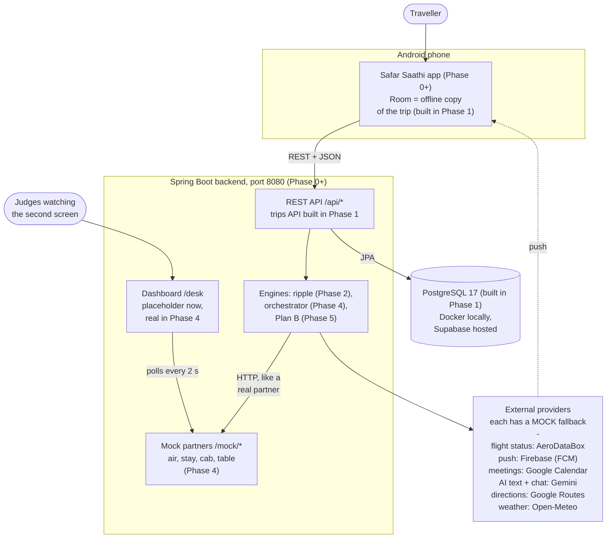
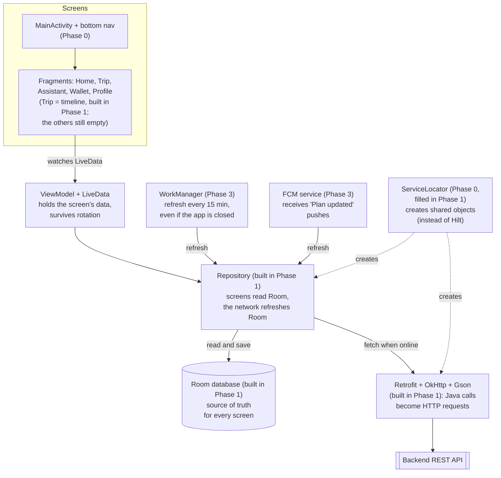
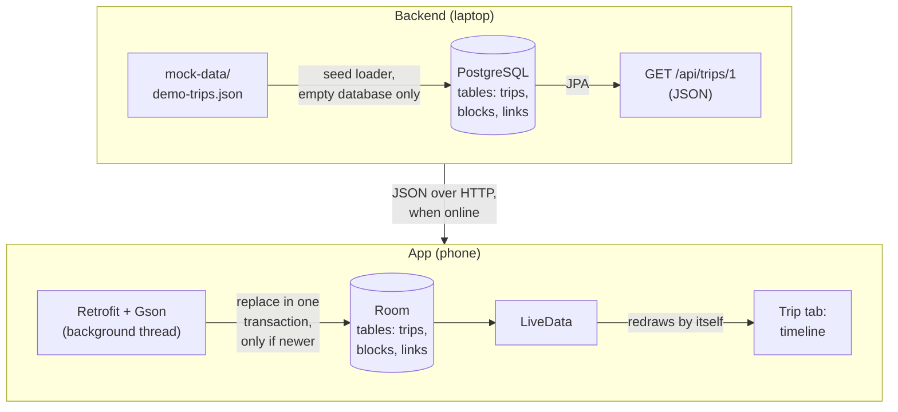
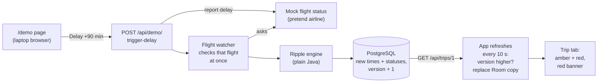
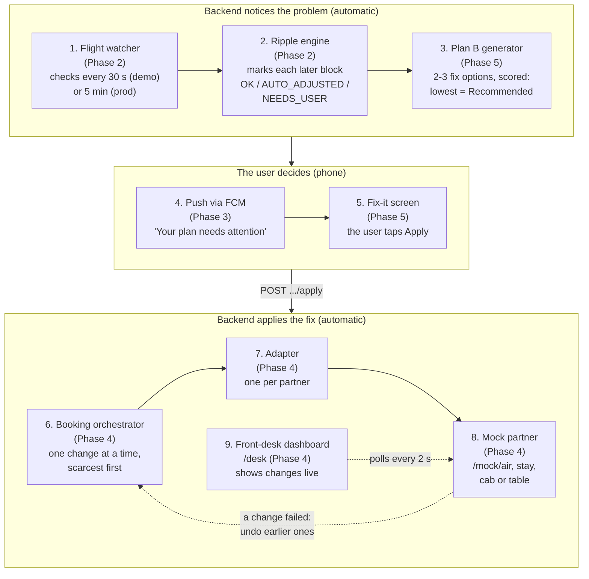

# Safar Saathi: Architecture

A plain-English tour of how the pieces fit together. Next to each part, **(Phase N)** says when we build it (see
[CLAUDE.md](../CLAUDE.md) §9), and **built** marks what exists already. Phase 0 built the skeletons: the backend
answers `GET /api/health` and the app has five tabs. Phase 1 built the trip data end to end: database tables, the
demo-trip seed, `GET /api/trips/{id}`, Retrofit + Room in the app and the Trip timeline, which also works offline.
[Section 3](#3-phase-1-data-flow-from-seed-file-to-screen) follows one trip from the seed file to the screen.
Phase 2 (in progress) adds the ripple engine, the demo controls and the `/demo` page for tonight's demo:
[section 4](#4-what-happens-when-a-flight-is-delayed) starts with what works tonight.

The diagrams are written in [Mermaid](https://mermaid.js.org/). GitHub draws them as pictures automatically. In VS Code,
use a Markdown preview with Mermaid support.

---

## 1. The big picture

How to read it:

- **Android app** is what the traveller uses. It keeps its own copy of the trip in **Room** (a small database on the
  phone), so the timeline, boarding pass and Plan B still open with no internet.
- **Backend** is one Spring Boot app. It owns the trip data, runs the engines, hosts the pretend partner systems and
  serves the front-desk dashboard.
- **PostgreSQL** is the backend's database: Docker on our laptops (`docker-compose.yml`), Supabase when hosted. Since
  Phase 1 it holds the trips, blocks and links. **Flyway** creates the tables from numbered SQL files in
  `backend/src/main/resources/db/migration` (V1, V2, ...), the same way on every laptop.
- **Mock partners** (`/mock/air`, `/mock/stay`, `/mock/cab`, `/mock/table`) pretend to be an airline, a hotel, a cab
  company and a restaurant, with realistic rules (fees, deadlines, nearly-full flights). They live inside the same
  backend, but the backend talks to them **over HTTP**, exactly as it would talk to a real partner. Swapping in a
  real partner later means changing one adapter class.
- **External providers** are real services that we call only when a key is configured. Each has a **mock** twin, so
  the whole demo runs with zero keys (table below).
- **Front-desk dashboard** (`/desk`) is a web page that shows the partners' bookings changing live. It is the second
  screen in the demo.

### External providers: mock or real?

| Provider | Used for | Mock fallback (no key) | Built in |
|---|---|---|---|
| AeroDataBox (RapidAPI) | Flight status | Delays we trigger ourselves via `/api/demo/*` | Phase 2 |
| Firebase Cloud Messaging | Push notifications to the phone | No real push is sent | Phase 3 |
| Google Calendar | Moving the client meeting | Mock calendar inside the backend | Phase 4 |
| Gemini | Plain-language explanations, translation, chat | Ready-made template text | Phase 6 |
| Google Routes API | Door-to-door directions | Travel time estimated from distance | Phase 7 |
| Sarvam AI | Cloud voice for Indian languages | Android's built-in voice | Stretch |
| Open-Meteo | Weather | Not needed: no key, always real | When a screen needs it |

Each provider is a Java **interface** with two implementations, for example `FlightStatusProvider` →
`AeroDataBoxProvider` (real) and `MockFlightStatusProvider` (mock). At startup the backend picks one per service:

- key empty → **MOCK**
- credentials file path empty, or the file doesn't exist → **MOCK**
- otherwise → **REAL**

The backend prints the choice for each service in its startup log and in `GET /api/health`. It never prints key values.
See [api.md](api.md#get-apihealth).

---

## 2. Inside the Android app

The pattern is called **MVVM**. Each layer only talks to the one below it:

- **Fragment** draws one tab and forwards taps to its ViewModel. It has no database or network code.
- **ViewModel + LiveData**: the ViewModel keeps the data a screen needs. LiveData is a value the screen *watches*: when
  it changes, the screen redraws by itself. A ViewModel survives screen rotation, so nothing reloads.
- **Repository** is the only class that knows where data comes from. Screens always read from **Room** (instant, works
  offline). When online, the repository fetches from the backend and overwrites Room **only if the server's trip
  `version` is newer**, or the trip was seeded again (section 3 has the exact rule).
- **Room** is Android's SQLite database with Java annotations. **Retrofit** turns a Java interface into HTTP calls,
  and Gson converts JSON to Java objects.
- **ServiceLocator** is one plain Java class that creates the shared objects (database, Retrofit, repositories) once and
  hands them out. It is our simple replacement for a dependency-injection library like Hilt.
- **WorkManager** is Android's scheduler for background jobs. It survives app restarts and respects battery saving.
- **FCM** (Firebase Cloud Messaging) receives pushes from the backend, such as "Plan updated". A push triggers a refresh
  or opens the Fix-it screen.

---

## 3. Phase 1 data flow: from seed file to screen

Built in Phase 1. This is the path one trip takes, and everything later builds on it:

1. **Seed loader (backend).** At startup, Flyway first creates the tables from
   `backend/src/main/resources/db/migration/V1__create_trips_blocks_links.sql`. Then, if the database has no trips
   yet, the seed loader reads `mock-data/demo-trips.json` and saves the three demo trips. The times in that file are
   relative ("day 0, 08:00"). The loader turns them into real times: the trip day is today in India (from the backend's
   injected `Clock`) plus `safarsaathi.seed.day-offset` days (default 1 = tomorrow). Details:
   [mock-data/README.md](../mock-data/README.md).
2. **`GET /api/trips/{id}` (backend).** Reads the trip, its blocks and its links through JPA and returns them as one
   JSON answer, with times in `+05:30`. Fields and errors: [api.md](api.md#get-apitripsid).
3. **Retrofit (app).** The repository fetches demo trip 1 (the constant `AppConfig.DEMO_TRIP_ID`) on a background
   thread, and Gson turns the JSON into Java objects.
4. **Room (app).** Room has the same three tables, and the server's ids are the Room primary keys. The repository
   replaces the saved trip, its blocks and its links in **one Room transaction** (all or nothing, so a screen never
   sees half a trip) when:
   - there is no saved copy yet, or
   - the server's `version` is higher than the saved one, or
   - the server's `createdAt` differs from the saved one: the database was seeded again, so `version` started at 1
     again.

   Otherwise it only updates `lastSyncedAt`, a phone-only field that remembers when the app last heard from the server.
5. **LiveData → timeline (app).** The Trip tab watches LiveData that comes straight from Room. When Room changes, the
   timeline redraws by itself.

**Offline = Room only.** When the backend can't be reached (backend stopped, airplane mode), step 3 fails and nothing
else changes: the timeline keeps showing the saved copy from Room, with "Offline · showing your saved plan". The network
only ever *refreshes* Room; no screen reads the network directly. Database and network work never run on the main
(screen) thread, so the app never freezes while it waits. The one thing the app can't do offline is fetch the trip for
the very first time.

---

## 4. What happens when a flight is delayed

### Tonight's version (Phase 2, in progress)

1. **Delay +90 min** on the `/demo` page calls `POST /api/demo/trigger-delay`. That plays the airline: it reports
   "block 1 is 90 minutes late" to the **mock flight-status provider** (package `watcher`; the real AeroDataBox one is
   used only when `AERODATABOX_API_KEY` is set), then makes the **flight watcher** check that flight at once. The
   watcher's timer also checks every 30 seconds in demo mode, so a real delay takes the same path. Each reported change
   is applied once, like an airline announcing a delay once.
2. The **ripple engine** (package `ripple`, plain Java with no Spring or database code, so it's easy to unit-test)
   walks the links from the flight and decides OK / AUTO_ADJUSTED / NEEDS_USER for each later block. The rules are in
   [api.md](api.md#post-apidemotrigger-delay).
3. The backend saves the new times and statuses, notes the disruption (table `disruption_events`) and adds 1 to the
   trip's `version`, all in one transaction.
4. The app asks for the trip again every 10 seconds while the Trip tab is on screen (and when you pull the timeline
   down), sees the higher `version` and replaces its Room copy. LiveData redraws the timeline: amber for blocks we
   moved, red for blocks that need the traveller, plus a red banner.

**Reset demo** (`POST /api/demo/reset`) deletes the trips and loads the demo trips again, with a new `createdAt`, so
the app replaces its copy even though `version` is back to 1.

### The full flow (Phases 2–5)

This is the heart of the final demo: the domino effect, end to end. Read it top to bottom: the backend notices the
problem by itself, the user makes one decision on the phone, and the backend applies the fix by itself.

Step by step:

1. **Flight watcher**, a Spring `@Scheduled` job, asks the flight-status provider about every active flight. In the
   demo we fake the delay ourselves with `POST /api/demo/trigger-delay`.
2. **Ripple engine** walks the trip's links like dominoes: the flight lands late, so bag claim ends late, so the cab
   must move, and so on. Each later block becomes **OK**, **AUTO_ADJUSTED** (shifted for free, e.g. the cab pickup)
   or **NEEDS_USER** (e.g. the client meeting, which the user must decide about). The engine is plain Java with unit
   tests, and it gives the same answer every time.
3. **Plan B generator** builds 2–3 fix options and scores them:
   `score = extra cost + time weight × minutes lost + 50,000 if the anchor is missed + change fees`.
   The time weight depends on the purpose of travel (Business 10, Exam 15, Holiday 2, ...). The lowest score is
   **Recommended**. AI (Gemini) only writes the plain-language explanation. **It never does the time or money maths.**
4. **Push**: Firebase Cloud Messaging tells the phone "Your plan needs attention".
5. **Fix-it screen** shows what broke plus the option cards. The user taps **Apply** on one, which calls
   `POST /api/trips/{id}/options/{optId}/apply`.
6. **Booking orchestrator** applies the option one booking at a time, **scarcest first**: flight → hotel → meeting →
   cab → restaurant (flight seats run out before cab slots). Every call goes into a change log. If one change fails,
   it **undoes the earlier ones in reverse order**, so the user never ends up half-rebooked. Bookings with no API get a
   ready-made WhatsApp/email message instead. On success, the trip's `version` goes up by 1 and a "Plan updated" push
   goes out.
7. **Adapter**: one class per partner (MockAir, MockStay, MockCab, MockTable, Google Calendar), all with the same four
   methods: `book`, `change`, `cancel`, `getRules`.
8. **Mock partner** answers like a real partner would, with its own rules (fees, deadlines) and a `fail-next` switch
   so we can demo the undo path.
9. **Front-desk dashboard** polls every 2 seconds, so the judges watch the hotel, cab and restaurant bookings change
   live.

---

## Who builds what, when

| Part | Lives in | Phase | Status |
|---|---|---|---|
| Backend skeleton, `/api/health`, MOCK/REAL provider check | `backend` (`health`, `config`) | 0 | Done |
| Android skeleton: MainActivity, bottom nav, 5 empty tabs | `android` | 0 | Done |
| Database tables (JPA + Flyway), demo-trip seed loader, `GET /api/trips/{id}`, Retrofit + Room, Trip timeline (offline from Room) | both | 1 | **In progress** |
| Ripple engine, demo triggers + `/demo` page, mock flight status, flight watcher, coloured timeline | `backend` (`ripple`, `demo`, `watcher`), `android` | 2 | **In progress** (built for tonight's demo, being tested) |
| "Do this now" card, push notifications, WorkManager refresh | both | 3 | Planned |
| Mock partners, adapters, orchestrator with rollback, `/desk` dashboard | `backend` (`mock`, `adapters`, `orchestrator`) | 4 | Planned |
| Plan B generator, Fix-it screen, message drafts | `backend` (`planb`), `android` | 5 | Planned |
| 5 languages, Gemini assistant, voice, personas | both (`ai`) | 6 | Planned |
| Wallet + boarding-pass scan, terminal map, true-cost compare, directions | both (`cost`) | 7 | Planned |
| Polish, offline test, demo script, Dockerfile + deploy notes | all | 8 | Planned |

A phase is **Done** only after the team's go-ahead (README's progress table and CLAUDE.md's phase list say the same).

## Rules that hold everywhere

- **Every external service sits behind an interface with a mock.** The demo must run with zero API keys.
- **Room is the app's source of truth.** Screens read from Room, and the network only refreshes Room.
- **Never on the main thread.** Database and network work run in the background, so the screen never freezes.
- **Never edit a Flyway migration that has already run.** Change the database with a new file (`V2__...sql`, then
  `V3__...sql`), so every laptop and the hosted database end up with the same tables.
- **AI explains, Java decides.** Times, costs and scores come from plain, unit-tested Java code.
- **Time:** `java.time` everywhere, zone **Asia/Kolkata**. The backend gets "now" from an injected `Clock`, so tests and
  demos can control the time.
